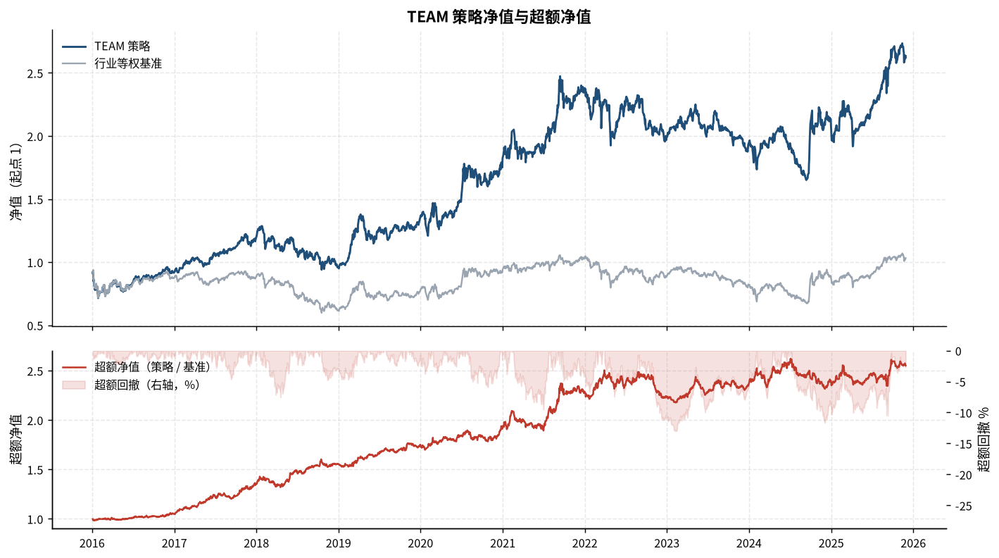
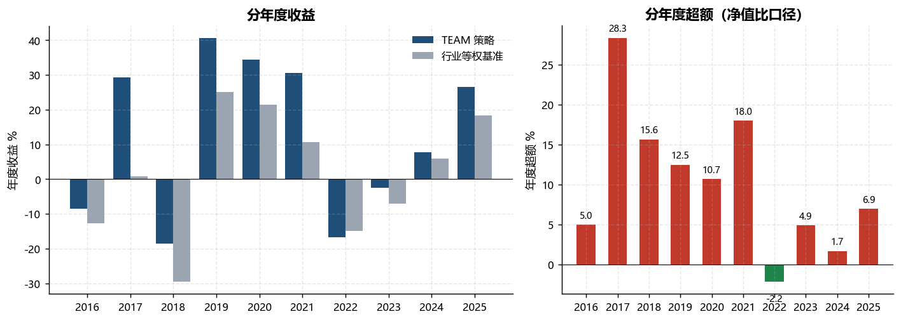
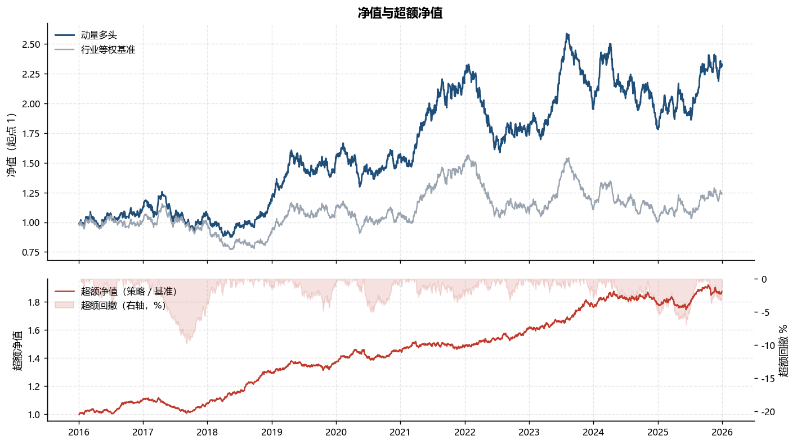

# Industry Rotation Toolkit

Research infrastructure extracted from a replication of the **TEAM industry-rotation strategy**
(Tianfeng Securities, Asset Pricing series no. 3) on China A-shares, 2016–2025. The replication
itself — the data pipeline, the factor definitions, the strategy rules and their calibration —
is a private project. This repository publishes the parts that are reusable for any monthly
cross-sectional strategy on industries or index baskets, a synthetic data set so that every
module runs end to end, and the headline results of the replication.

## The replication

TEAM looks at each of the 31 Shenwan level-1 industries from four vantage points —
**T**rading (market trend and crowding), **E**nterprise (financial-report prosperity),
**A**nalyst (forecast revisions) and **M**anager (mutual-fund behaviour) — screens out the
most crowded and the least prosperous industries, and holds the best-scoring of the rest,
equally weighted. Signals are fixed at the close of the last trading day of each month using
only data available by then; the portfolio is held from the next trading day to the following
month end. The benchmark is the equal-weight portfolio of the 31 industries, rebalanced monthly.

The replication rebuilt the whole chain: a resumable 14-step data pipeline over public and
licensed sources, point-in-time panels for prices, financial reports, analyst forecasts and
fund holdings, the four factor families, the composite strategy with ablations and sensitivity
grids, an extension of the same factors to ETF-tracked indices, and a chartbook whose
conclusions are generated from the run outputs.

### Results

Own runs with the default configuration, January 2016 to December 2025, **before transaction
costs**, against the equal-weight industry benchmark. These are in-sample results of a
replication, not a track record.

| | TEAM on 31 industries |
|---|---|
| Information ratio (monthly excess, annualised) | 1.05 |
| Maximum drawdown of the excess NAV | −13 % |
| Rebalancing | monthly, equal weight |





The factor definitions, parameters and screening rules behind these numbers are not part of
this release.

## What is in this repository

| Layer | Modules | What they do |
|---|---|---|
| Data utilities | `etl/utils.py` | per-run log files, rate limiter, exponential-backoff retry |
| Base layer | `strategy/base/` | trading calendar and rebalancing dates; point-in-time availability dates for financial reports (announcement date → next trading day, statutory-deadline fallback, anomaly handling); industry membership panel; industry returns rebuilt from constituents where the index has no history, with calibrated weighting and dividend-bias adjustment; benchmarks; period-return aggregation with an anchored start |
| Factor layer | `strategy/factors/` | `FactorSpec` registry (name, dimension, sign, builder, outputs), parquet storage, cross-sectional and rolling z-scores, as-of sampling, stock-to-industry aggregation; diagnostics: coverage, monthly rank IC, ICIR, factor correlations |
| Backtest layer | `strategy/backtest/` | monthly engine (weights drift within the month, turnover and cost accounting), performance metrics with excess measured as a NAV ratio, yearly tables; single-factor long / short / long–short / N-group tests |
| Index pool | `strategy/index_pool/` | many-to-many membership matrix with snapshot carry-forward; equal-weight and MAD-trimmed aggregation of stock statistics to indices; membership explode and count share |
| Optimiser | `strategy/etf_rotation/optimize.py` | SLSQP weights that keep a basket's style exposures close to a benchmark, with a per-index cap and per-style tolerance bands; a penalty formulation for diagnostics; relaxation and equal-weight fallback when infeasible |
| Chartbook | `chartbook/` | `Chapter` / `Block` document model, house style, NAV-with-excess, yearly bars, monthly heat map, generic heat map, drawdown events, rolling metrics; self-contained HTML with a navigation sidebar, and PDF |
| Reports | `strategy/reports.py` | CSV / JSON archive of every run's diagnostics, the only input the chartbook reads |

Design rules the code keeps to:

- **One-way layering.** Factors and backtests read only through `strategy.base`; the chartbook
  reads only saved reports and never recomputes a backtest.
- **Point-in-time by construction.** Every "available date" is a trading day on which the datum
  could be used at the close: the next trading day after an announcement or report date, the
  statutory disclosure deadline when the announcement date is missing or implausible.
- **Factors are computed once and are pool-independent.** Cross-sectional operations (rank,
  z-score, missing-value handling, compositing) happen on the strategy side over the eligible
  set of each month, so changing the universe never requires rebuilding factors.
- **Every run is archived.** Logs and structured diagnostics (coverage, rank IC, factor
  correlations, benchmark statistics) are written per layer, and the chartbook is built from
  them.
- **Configuration in one place.** `strategy/config.py` holds paths and generic settings; a
  factor module owns its own parameters and registers itself.

## Quick start

```bash
pip install -r requirements.txt                   # Python >= 3.11
python scripts/make_synthetic_data.py             # ~10 s, writes .data/ (git-ignored)

python examples/01_single_factor_test.py          # register two factors, diagnostics, long/short/group tests, saved reports
python examples/02_chartbook.py                   # output/example_chartbook.html and .pdf from the saved reports
python examples/03_index_pool_and_optimizer.py    # industry vs index aggregation, style-constrained weights
python examples/04_pit_alignment.py               # availability dates of quarterly reports
```

The synthetic data set has 600 stocks in 31 industries over 2010–2025, 12 overlapping indices
with semi-annual membership snapshots, a quarterly report table with announcement dates, and
market benchmarks. Returns follow a market factor plus an industry component with a slowly
mean-reverting drift, so a momentum-type factor has something to find; nothing in it resembles
any market.



*Example 02 on synthetic data: 12-1 month industry momentum, long top 5, monthly. Not a market
result.*

## Data

No data are distributed. The formats every reader expects are documented in
[`docs/data_formats.md`](docs/data_formats.md); `scripts/make_synthetic_data.py` writes all of
them and is the executable version of that specification. A real pipeline only has to produce
the same files under `.data/`.

## Not in this release

- The data pipeline and every data set derived from it.
- The factor modules of the four dimensions, the composite strategy, the ETF-track taxonomy and
  the ETF backtests, together with their parameters and the ablation results.
- Run archives beyond the headline figures above.

## Language

The README and the documentation in `docs/` are in English. Module docstrings, comments and
chart labels are in Chinese, the working language of the project, and are kept as written.

## References

- Tianfeng Securities, *TEAM industry rotation strategy* (《TEAM 行业轮动策略》), Asset Pricing
  series no. 3.

## License

Code is released under the [MIT License](LICENSE). The research report and any market or vendor
data you supply remain subject to the terms of their owners.
